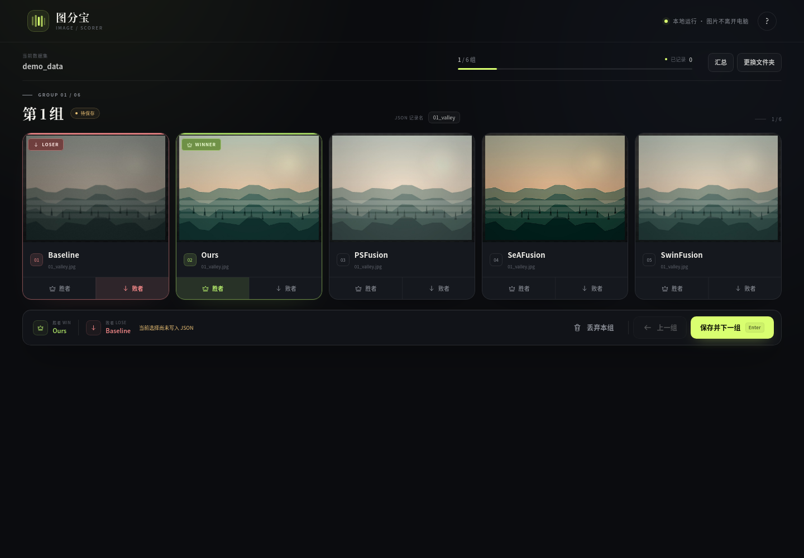
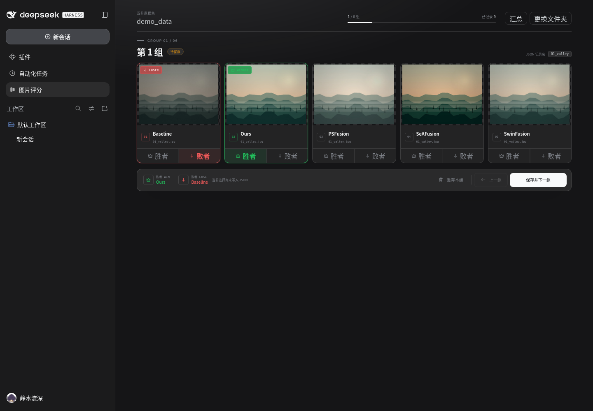

# 图分宝 · 人工图片评分

一个**零依赖、本地运行**的图片偏好标注工具。选定包含 5 个等量子文件夹的根目录后，它会按顺序把每个子文件夹的第 N 张图配成一组，同屏展示 5 张图；你为每组选出胜者与败者，结果实时写入根目录下的 `scores.json`。

## 功能

- 自动校验：根目录有且仅有 **5 个子文件夹**，且每个子文件夹的图片数量相同。
- 五图对比：图片下方固定显示所在**子文件夹名称**和文件名，避免看错来源。
- 胜/败互斥：每组的胜者和败者各选一张，同一张图不能兼任；再点一次可取消。
- 实时保存：点击「保存并下一组」后立即写入 JSON，可随时关闭浏览器。
- 丢弃本组：没有明确偏好时不写入 JSON；若该组之前已有记录，会删除旧记录。
- 自动恢复：再次载入同一目录会读取已有记录并回显之前的选择。
- 完成汇总：查看已记录/未记录数量，下载 JSON，或跳到下一个未记录组。
- 大图检查：点击任意图片或右上角放大按钮查看原图。
- 纯本地：图片通过本机服务读取，不经过网络，也不需要账号。



## DSH 侧栏插件

仓库同时包含一个可安装到 DeepSeek Harness 的原生侧栏插件，安装后直接在当前 Web GUI 内评分，不需要另开 8765 页面：

- 插件包：`dsh-plugin/`
- 安装说明：[dsh-plugin/README.md](dsh-plugin/README.md)
- 安装路径：`/home/video408/Project/img_process/dsh-plugin`
- 打包文件：[dist/dsh-image-scorer-0.1.2.tgz](dist/dsh-image-scorer-0.1.2.tgz)



## 快速开始

要求 **Python 3.10+**，运行时不需要安装任何第三方包。

```bash
cd /home/video408/Project/img_process
./start.sh
```

或：

```bash
python3 app.py
```

默认会自动打开浏览器；如果没有，请访问：

```
http://127.0.0.1:8765/
```

常用参数：

```bash
python3 app.py --port 8766        # 换端口
python3 app.py --no-browser       # 不自动打开浏览器
python3 app.py --host 0.0.0.0     # 仅在你明确需要局域网访问时使用
```

### 先用演示数据试试

仓库自带 5 个文件夹 × 6 张图的测试数据。在首页点击「没有数据？用内置演示图片体验」，或直接选择：

```
/home/video408/Project/img_process/demo_data
```

## 数据目录要求

```text
根目录/
├── 子文件夹 A/
│   ├── 0001.jpg
│   ├── 0002.jpg
│   └── ...
├── 子文件夹 B/
│   ├── 0001.jpg
│   ├── 0002.jpg
│   └── ...
├── 子文件夹 C/
├── 子文件夹 D/
├── 子文件夹 E/
└── scores.json        # 首次保存后自动生成
```

- 5 个子文件夹按名称自然排序（`img2` 排在 `img10` 前面）。
- 每个子文件夹内的图片同样按文件名自然排序，各取第 1 张组成第 1 组，第 2 张组成第 2 组，依此类推。
- 支持的图片格式：`.jpg` `.jpeg` `.png` `.webp` `.bmp` `.gif` `.avif`。
- 隐藏文件/隐藏文件夹会被忽略；子文件夹内的非图片文件会被忽略。
- 请确保 5 个子文件夹中对应序号的图片属于同一组对比对象。

## 操作说明

1. 在首页输入根目录路径，或通过「浏览」选择目录，点击「开始评分」。
2. 在每组 5 张图中点击某张图下方的「胜者」和另一张图的「败者」。
3. 点击「保存并下一组」（或按 `Enter`）写入 JSON 并前进。
4. 如果这一组没有可区分的优劣，点击「丢弃本组」（或按 `D`）。该组不会保留在 JSON 中。
5. 随时点右上角「汇总」查看进度、复制 JSON 路径或下载 JSON。

快捷键：`Enter` 保存并下一组，`←` 上一组，`D` 丢弃本组，`Esc` 关闭弹窗。未保存的选择在本次会话内切换分组时会保留；只有点击保存才会写入文件。

## 输出 JSON

文件位置：**所选根目录**下的 `scores.json`。

```json
{
  "01_valley": {
    "win": "Ours",
    "lose": "Baseline"
  },
  "02_coast": {
    "win": "SeAFusion",
    "lose": "PSFusion"
  }
}
```

- `win` / `lose` 的值为**子文件夹名称**，不是文件名。
- JSON 的键（记录名）默认是 5 张图共享的文件名（**不含扩展名**）。
- 如果 5 张图的文件名不一致，则取按名称排序后的第一个子文件夹中的文件名作为记录名；若发生重名，会自动追加 `__2`、`__3` 等后缀以保证唯一。
- 丢弃的组不会出现在 JSON 中；如果它之前已经保存过，丢弃操作会删除对应键。
- 写入采用临时文件 + 原子替换，避免中断时产生半个 JSON。

## 项目结构

```text
img_process/
├── app.py                  # 启动入口
├── scorer/
│   ├── dataset.py          # 目录扫描、自然排序、JSON 读写
│   └── server.py           # 本地 HTTP 服务与 API
├── web/
│   ├── index.html
│   ├── styles.css
│   └── app.js
├── demo_data/              # 5 × 6 张演示图
├── tests/                  # 标准库 unittest
├── screenshots/
├── tools/make_demo.py      # 重新生成演示数据（需要 Pillow）
└── start.sh
```

## 开发与测试

```bash
python3 -m unittest discover -s tests -v
```

重新生成演示数据（仅这一步需要 Pillow）：

```bash
python3 tools/make_demo.py
```

## 常见问题

**提示“必须有且仅有 5 个子文件夹”**  
请检查根目录下是否混入了额外的非隐藏文件夹；图片需要直接放在这 5 个子文件夹里。

**提示“图片数量必须相同”**  
报错会列出每个子文件夹的实际图片数，补足或删除多余图片后重新载入。

**提示评分文件不是合法 JSON**  
请修复或删除根目录下的 `scores.json`。为避免覆盖人工数据，工具不会自动重置损坏的 JSON。

**图片显示“加载失败”**  
确认文件扩展名与实际格式一致（改后缀不会改变编码），并优先使用 `.jpg` / `.png` / `.webp`。

**端口被占用**  
使用 `python3 app.py --port 8766` 换一个端口。
